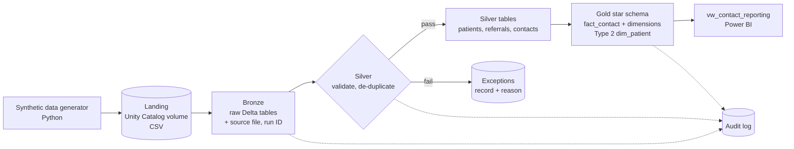
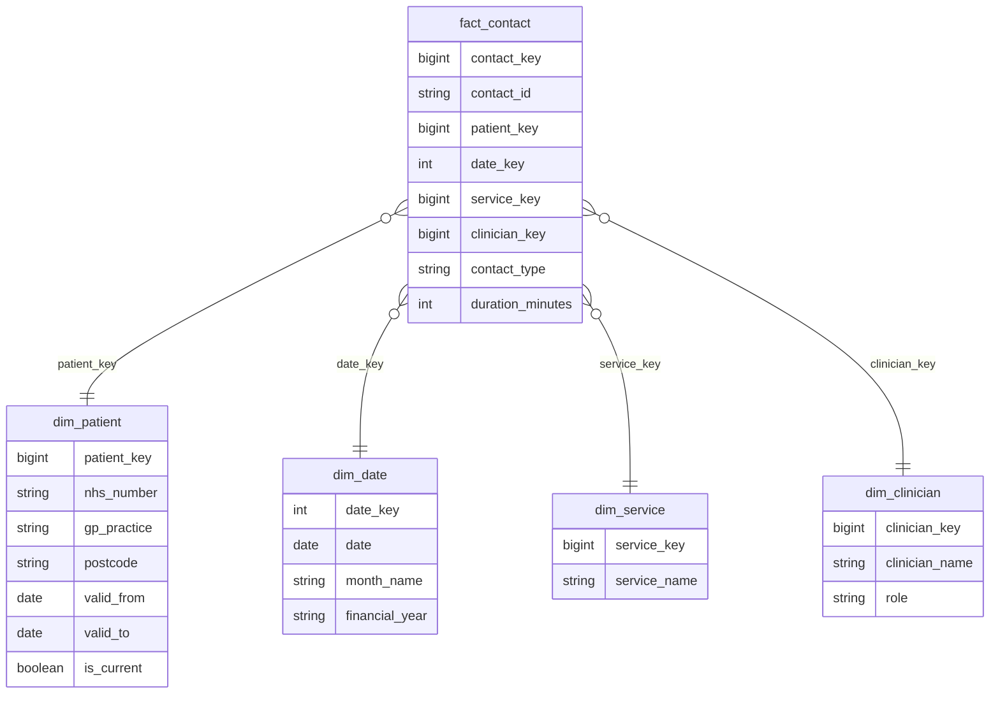

# NHS Community Health Lakehouse

A bronze, silver and gold Delta lakehouse on **Databricks**, built with **PySpark**, **Delta Lake** and **Unity Catalog**, for NHS-style community health data: patients, referrals and clinical contacts across four services (Wound Care, Lymphoedema, Podiatry and Tissue Viability).

It reproduces the problems real NHS reporting pipelines deal with: duplicate patients, invalid NHS numbers, impossible dates, repeated exports and records that point at nothing. It solves them with validation, quarantine, reconciliation and audit logging, then publishes a star schema with Type 2 patient history for Power BI.

> **All data is synthetic.** NHS numbers are generated only in the 999 range, which the NHS reserves for testing, and no real patient data is used anywhere.

## Architecture



| Layer | What happens | Tables |
| --- | --- | --- |
| Landing | Synthetic CSV extracts written to a Unity Catalog volume | `/Volumes/workspace/nhs_lakehouse/raw/landing/...` |
| Bronze | Raw load, every column as text, plus `_source_file`, `_ingested_at`, `_run_id`. Row counts are checked against the source files. | `bronze_patients`, `bronze_referrals`, `bronze_contacts`, `bronze_clinicians` |
| Silver | Types standardised, data quality rules applied, failures quarantined, patients de-duplicated on NHS number | `silver_patients`, `silver_patient_xref`, `silver_referrals`, `silver_contacts`, `exceptions` |
| Gold | Star schema with point-in-time patient history, reconciled to silver | `fact_contact`, `dim_patient`, `dim_date`, `dim_service`, `dim_clinician`, `vw_contact_reporting` |
| Audit | Rows read, loaded and rejected, with status, for every step of every run | `audit_log` |

## Data quality rules (silver)

Rows that break any rule are written to `exceptions` with the rule names, the raw record as JSON and the run ID, instead of silently breaking a report.

| Entity | Rule | Why it matters |
| --- | --- | --- |
| Patients | `missing_nhs_number`, `invalid_nhs_number` (Modulus 11 check digit) | A patient can't be matched safely without a valid NHS number |
| Patients | `missing_date_of_birth`, `future_date_of_birth` | Age-based reporting would be wrong |
| Patients | `duplicate_superseded` | The same NHS number registered twice: the latest record survives, older IDs are mapped to it |
| Referrals | `missing_referral_date`, `future_referral_date`, `unknown_patient`, `missing_service` | Referrals drive caseload and waiting-time reporting |
| Contacts | `duplicate_contact` | The same contact exported twice would double-count activity |
| Contacts | `missing_contact_date`, `future_contact_date`, `contact_before_referral` | Impossible timelines |
| Contacts | `unknown_referral`, `unknown_patient` | Orphan records that no report could attribute |
| Contacts | `invalid_duration` | Zero or negative appointment lengths |

With the default seed (2,000 patients) the generator produces 2,060 patient rows, 3,572 referrals and 25,505 contacts. Silver keeps 1,962 unique patients and rejects roughly 6% of contacts, most commonly as duplicates, orphans or impossible dates.

All rules use built-in Spark functions only (no Python UDFs), including the NHS number check, so they run efficiently on serverless compute.

## Gold star schema



- **Grain:** one row in `fact_contact` per clinical contact.
- **Type 2 history:** `dim_patient` tracks GP practice and postcode. When either changes, the current version is closed (`valid_to`, `is_current = false`) and a new version is added. Each contact joins to the version that was valid **on the contact date**, so past activity keeps reporting under the practice the patient had at the time.
- **Idempotent:** re-running the load with unchanged data changes nothing.
- **NHS financial year** (April to March) in `dim_date`, for example `2025/26`.
- **Reconciliation:** the gold step fails if `fact_contact` doesn't match the clean silver contacts row for row, or if any fact row is missing a dimension key.

## Run it on Databricks Free Edition

1. Sign up for [Databricks Free Edition](https://www.databricks.com/learn/free-edition).
2. In the workspace, go to **Workspace → Create → Git folder** and paste this repository's URL.
3. Open the `notebooks` folder and run them in order:
   - `00_generate_synthetic_data` creates the schema, the volume and the CSV extracts
   - `01_bronze_ingest`
   - `02_silver_validate` (its last cell shows the exceptions summary)
   - `03_gold_star_schema`
4. To see Type 2 history in action, run `04_simulate_patient_changes`, re-run 01 to 03, then run its last cell.
5. Open `05_kpi_queries` for contacts per service per month, active caseload, contact mix, data quality and pipeline health.

Every notebook has `catalog` and `schema` widgets (defaults `workspace` and `nhs_lakehouse`).

### Or deploy the job as code

`databricks.yml` is a [Databricks Asset Bundle](https://docs.databricks.com/aws/en/dev-tools/bundles/) defining a four-task job (generate → bronze → silver → gold) with a daily 06:00 schedule (paused by default), running on serverless compute.

```bash
databricks bundle validate
databricks bundle deploy -t dev
databricks bundle run nhs_lakehouse_daily -t dev
```

## Run the tests locally

```bash
pip install -r requirements-dev.txt     # PySpark needs Java 17 installed
pytest -v
```

- `tests/test_nhs.py` and `tests/test_generator.py` are pure Python.
- `tests/spark/` runs the validation rules, de-duplication, Type 2 logic, date dimension and point-in-time fact join on a local SparkSession. They are skipped automatically if PySpark isn't installed.
- GitHub Actions (`.github/workflows/tests.yml`) runs every test on each push and pull request.

To generate the CSV files without Databricks:

```bash
python scripts/generate_data.py --output-dir data/landing --patients 2000
```

## Project structure

```
├── databricks.yml                 Databricks Asset Bundle: the job as code
├── notebooks/
│   ├── 00_generate_synthetic_data.py
│   ├── 01_bronze_ingest.py
│   ├── 02_silver_validate.py
│   ├── 03_gold_star_schema.py
│   ├── 04_simulate_patient_changes.py
│   └── 05_kpi_queries.sql
├── src/lakehouse/
│   ├── generator.py               synthetic data with deliberate errors
│   ├── nhs.py                     NHS number Modulus 11 check (pure Python)
│   ├── quality.py                 silver rules, de-duplication, exceptions
│   ├── transforms.py              gold: Type 2 dimension, dimensions, fact
│   ├── audit.py                   audit log
│   └── config.py                  catalog, schema and table names
├── tests/                         pytest, including Spark tests
├── docs/data_dictionary.md
└── scripts/generate_data.py
```

## Design decisions

- **Bronze keeps everything as text.** Nothing is lost or rejected at ingestion, so any later rule can be re-run against the original values.
- **Quarantine, don't drop.** Bad rows go to `exceptions` with a reason, so they can be sent back to the service to fix at source.
- **Safe parsing.** `try_cast` and `try_to_timestamp` turn bad values into nulls that a rule then flags, instead of failing the whole job.
- **Duplicates re-pointed, not lost.** Contacts recorded against an old duplicate patient ID are mapped to the surviving patient through `silver_patient_xref`.
- **Materialise before MERGE.** The Type 2 changes are saved to a staging table before `dim_patient` is updated, because Spark is lazy and would otherwise compare against the table it is changing.
- **Logic in modules, not notebooks.** Notebooks orchestrate; the rules live in `src/lakehouse`, where they are unit-tested.

## Author

Anish Bhuptani · [github.com/anish310899](https://github.com/anish310899)
